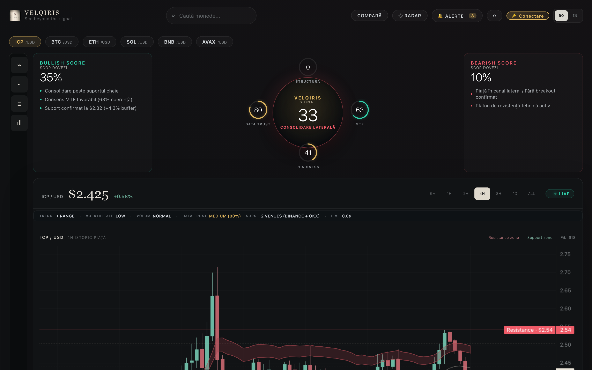

# VELQIRIS Total Portfolio

> Software-asset acquisition: six tested AI, fintech and x402 systems, a 55-package developer source library, ten competition builds and four specialist extensions.

[⚡ Launch Live 60 FPS WebGL2 Demo](https://velqiris-acquisition.netlify.app/heatmap.html) · [View the acquisition overview](https://velqiris-acquisition.netlify.app/) · [Inspect the public proof](https://velqiris-acquisition.netlify.app/proof) · [Contact the seller](mailto:chitara.trading@proton.me?subject=VELQIRIS%20Total%20Portfolio%20buyer%20inquiry)

## Acquisition thesis

VELQIRIS Total Portfolio consolidates approximately two years of software engineering into one controlled source-code acquisition for a technical founder, product studio or fintech/AI team. It is a **pre-revenue software-asset transaction**, not an operating cash-flow business.

## Principal systems

| System | Buyer outcome | Public evidence |
|---|---|---|
| MYMSYL | Multi-venue market intelligence, liquidity workflows and evidence provenance | 860/860 unit tests observed passing |
| ASYMTRACE | Local-first risk, supply provenance and tamper-evident analysis | 166 functional tests observed passing |
| VELQIRIS | MCP tools, deterministic consensus, PayPal evidence gates and Base x402 code | 450/450 web unit and 20/20 Rust tests observed passing |
| CRYCASH | Payment-certainty and safe-cashflow operating infrastructure | 419/422 observed passing; three open items disclosed |
| MIMARIO | Privacy-first local revenue and engineering operating system | 130/131 observed passing; one open item disclosed |
| GENESIS | x402/Base control plane and 55 vetted source packages | 313/314 observed passing; one open item disclosed |

The scheduled portfolio also includes ten competition builds and four specialist extensions: STUPUL, BMW Diagnostic Studio, MARMIYO and AEGIS.

## Release integrity

- 12 release components and 5,455 scanned files.
- 55 nested GENESIS source packages inspected before packaging.
- Confidential buyer archive SHA-256: `0e1e735544e958514b05bbe1597071920f0b22f32cf313e390451e613f2859e3`.
- Automated release scan found zero real `.env` files, forbidden runtime/archive files, temporary files or complete PEM private-key blocks.
- Across the disclosed ledger: 2,745 observed test executions passed and 11 remain open. Suites may overlap; all known open items are disclosed.

The confidential archive and proprietary sources are **not published in this repository**. Qualified buyers receive controlled diligence access after written terms.

## Transaction position

- **Exclusive Fast-Close Buyout (Total Portfolio):** **$6,900 USD** (valid 7-day window).
- **Single Exclusive Flagship Carve-Out:** **$3,900 USD** (Choice of MYMSYL, VELQIRIS x402 Stack, or ASYMTRACE+GENESIS).
- **Settlement:** Same-day Native USDC on Base (`0x833589fCD6eDb6E08f4c7C32D4f71b54bdA02913`) or Escrow.com.
- Exact assets, rights, public-code treatment, exclusions, support and settlement are defined in a signed asset schedule.

## Commercial disclosures

The portfolio is pre-revenue. No traffic, customer, MRR, guaranteed-return or guaranteed-sale claim is made. Public repositories are non-exclusive. Third-party forks are excluded from proprietary value.

## Buyer contact

Email `chitara.trading@proton.me` with your intended use case, whether you are considering the total portfolio or one flagship, target closing timeframe and preferred settlement route.
